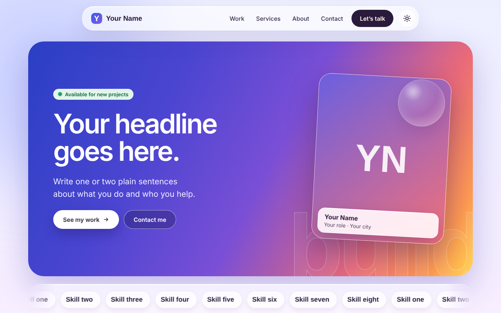
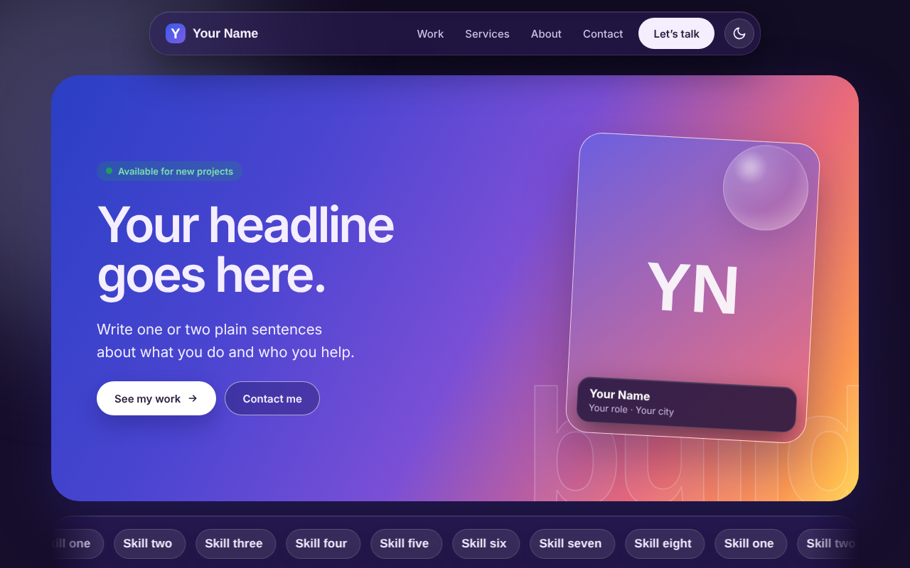
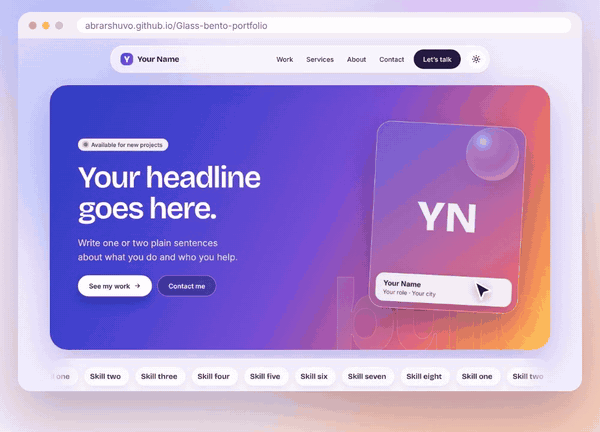

<div align="center">



# 🫧 Glass Bento Portfolio Template

**A free, frosted-glass portfolio for students and freelancers. Fill in your details, push to GitHub, and you're live in minutes.**

[🌐 **Live demo**](https://abrarshuvo.github.io/Glass-bento-portfolio/) &nbsp;·&nbsp; [✨ **Use this template**](https://github.com/AbrarShuvo/Glass-bento-portfolio/generate) &nbsp;·&nbsp; [🐛 Report an issue](https://github.com/AbrarShuvo/Glass-bento-portfolio/issues)

  

</div>

---

## 👀 Preview

| Light | Dark |
|---|---|
|  |  |

<p align="center"><br><sub>One tap switches to dark mode, and it remembers the choice.</sub></p>

## 🎯 Why this exists

Most free portfolio templates are plain, heavy with frameworks, or need a build tool. This one is **plain HTML, CSS and a little JavaScript**: open it, edit the text, and publish.

## ✨ What you get

- 🪟 **Glass design system**: frosted panels, crystal bubbles and soft colour clouds, all from three classes
- 🌗 **Dark mode** with a toggle that remembers your choice
- 📄 **7 ready pages**: Home, Work, Case study, Services, About, Contact, 404
- 📬 **Working contact form** with no backend (uses [FormSubmit](https://formsubmit.co))
- 📱 **Mobile first**: tested down to 390px, no sideways scroll
- ♿ **Accessible**: skip link, visible focus rings, labelled form fields, reduced-motion support
- 🔎 **Share-ready**: Open Graph tags, structured data, print styles
- 🚫 **No framework, no build step, no npm**

## 🚀 Quick start

1. Click **[Use this template](https://github.com/AbrarShuvo/Glass-bento-portfolio/generate)** and create your repo.
2. Name it `YOUR-USERNAME.github.io` to get your main site, or anything else for a project site.
3. Go to **Settings → Pages → Deploy from a branch → `main` → `/ (root)`**.
4. Open your link in about a minute. 🎉

Try it on your computer first:

```bash
python -m http.server 8000
```

Then open http://localhost:8000. Use a server, not a double-click, so `404.html` works.

## 🛠️ Make it yours

Search the whole project (`Ctrl+Shift+F` in Cursor or VS Code) and replace:

| Find | Replace with |
|---|---|
| `Your Name` | your name |
| `you@example.com` | your email |
| `YOUR-USERNAME` | your GitHub username |
| `Your role`, `Your headline goes here.` | what you do |
| `Project one`, `Service one`, `Skill one` | your real projects, services and skills |

Then:

- 🖼️ Replace the **YN** initials blocks in `index.html` and `about.html` with your photo (a comment marks each spot)
- 📑 Copy `case-study.html` once per project
- 🌅 Add `images/og-cover.png` (1200×630) for link previews
- 📨 Send one test message through the contact form and confirm the email FormSubmit sends you

## 🗂️ What's inside

| File | What it is |
|---|---|
| `index.html` | Home |
| `projects.html` | All work |
| `case-study.html` | Case-study pattern |
| `services.html` | Services, process, FAQ |
| `about.html` | About, experience, tools |
| `contact.html` | Contact form |
| `404.html` | Not found |
| `styles.css` | All styling |
| `script.js` | Menu, dark mode, scroll progress, form helpers |

## 🎨 Design tokens

| Colour | Hex | Used for |
|---|---|---|
| Cream | `#FFF0E4` | page background |
| Plum | `#2A1B3D` | headings, dark buttons |
| Blue | `#3350DC` | primary accent |
| Violet | `#7A5CE6` | gradient middle |
| Coral | `#E8697A` | gradient middle |
| Orange | `#FF9A52` | warm accent |

Fonts: **Bricolage Grotesque** for headings and **Inter** for body text, from Google Fonts.

## 🤝 Contributing

Found a bug or have an idea? [Open an issue](https://github.com/AbrarShuvo/Glass-bento-portfolio/issues). Small fixes are welcome as pull requests.

## 📄 License

[MIT](LICENSE): free to use, including for client work. A link back is appreciated, never required.

---

<div align="center">

Built by **[Abrar Zamil](https://abrarshuvo.github.io)** · I clean data, build automations and make fast websites.

⭐ If this saved you time, a star helps other people find it.

</div>
